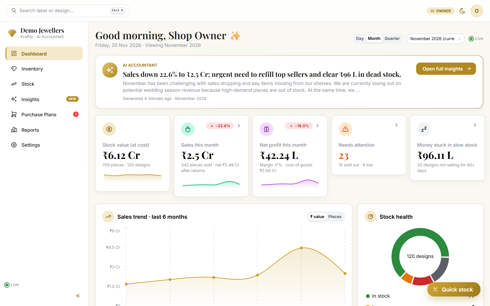
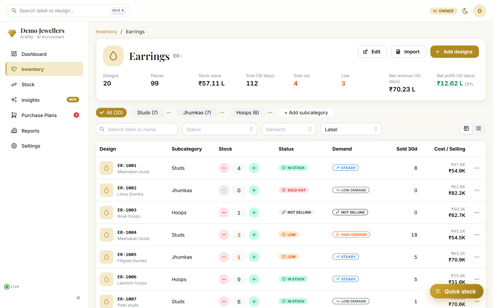
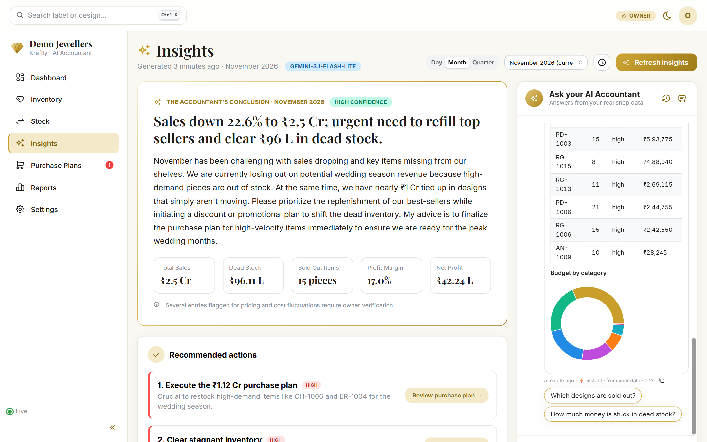
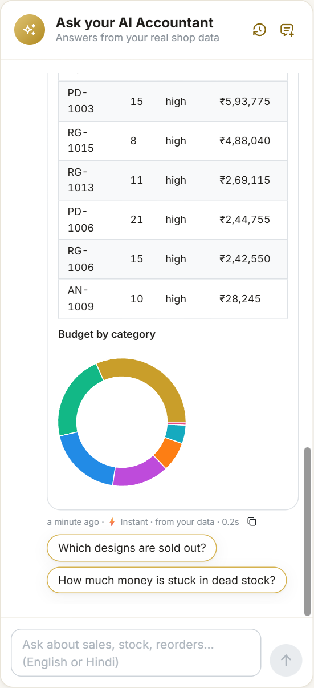
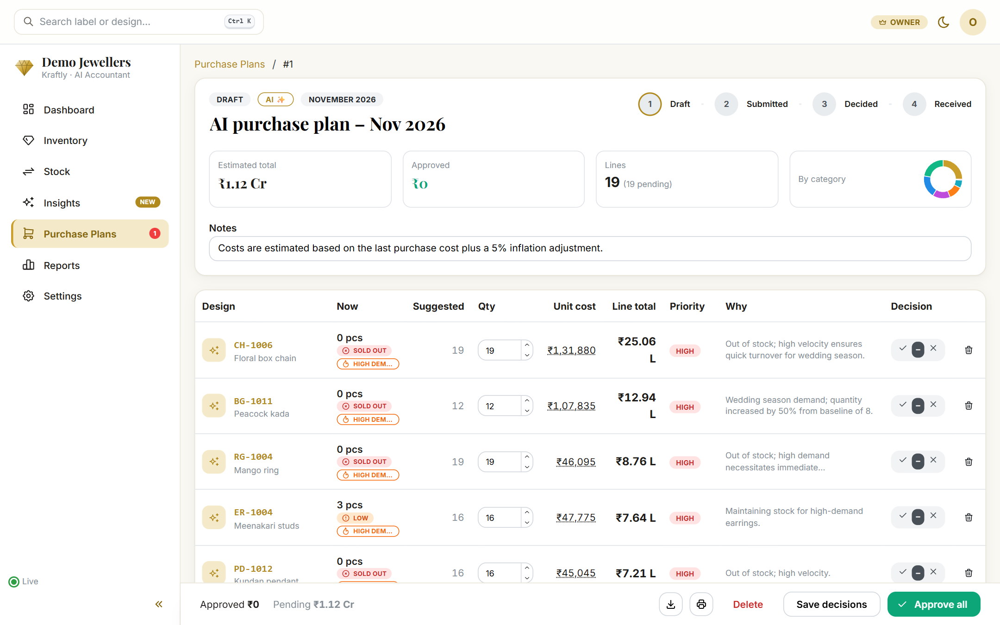
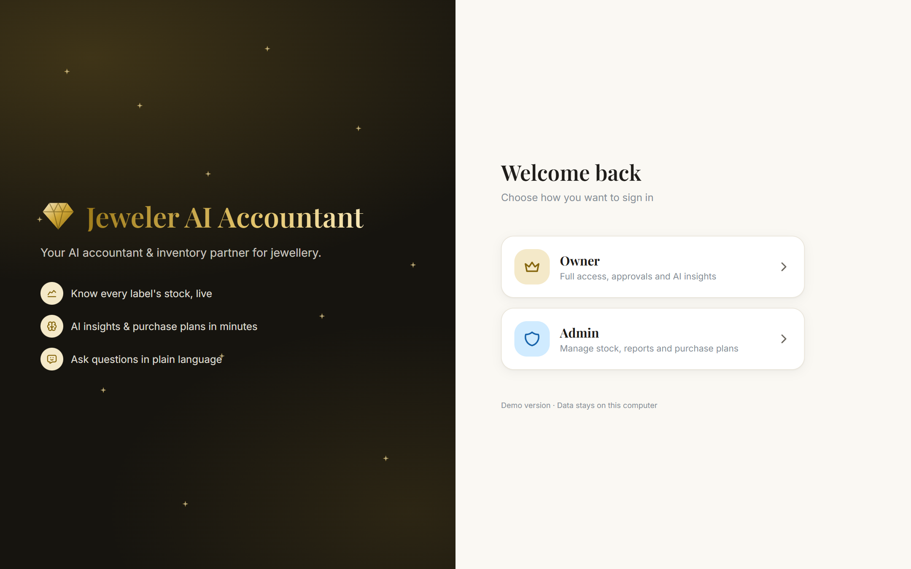
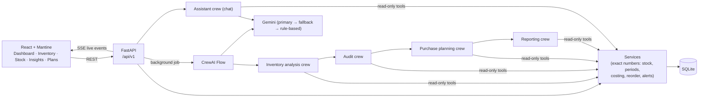

<div align="center">


# 💎 Karatly

### The AI accountant & inventory system for jewellery shops

**Karatly** tracks every design label's stock live, writes an AI monthly report with a purchase plan, and lets the owner ask questions about the shop in plain language.




</div>

---

## 🧩 The problem

A typical jeweller has many categories (necklaces, earrings, bangles…). Each category holds dozens of designs, and every design carries a unique tag such as **`ER-1012`** with its own stock count. Today, **4–5 accountants** check each label by hand in Excel, list what is sold out, estimate the purchase cost ("last price + ~5%"), and guess which designs sell well.

**This app does that work.** It keeps stock exact and live, does the costing automatically, and an **AI accountant built from a CrewAI multi-agent team** writes the analysis. **1–2 accountants** can then review it, and **the owner makes every decision.**

> 📄 More detail: [problem_statement.md](problem_statement.md) · [solution.md](solution.md) · [architecture.md](architecture.md)

---

## ✨ Features

| | |
|---|---|
| 🗂️ **Inventory, label by label** | Category → subcategory → design label → stock. Add 50 designs at once (labels are pre-filled, and you can paste from Excel), or import a full Excel sheet. |
| ➕➖ **Two-tap stock changes** | Every row has `−` / `+`. Record a sale, new stock, a return or a correction, with **Undo** on every entry. |
| 📅 **Day, month and quarter views** | Opening, received, sold and closing stock per label for any day, month or quarter (Indian financial-year quarters, Apr–Mar). Export to Excel. |
| 💰 **Net revenue & net profit** | For every design, subcategory and category: net revenue (sales − returns), cost of goods (average purchase cost) and net profit with margin %, for any day, month or quarter. |
| ⚡ **Live dashboard** | KPIs, stock health, sales trend, top sellers, alerts and rule-based "today at a glance" insights. It updates instantly over Server-Sent Events. |
| 🤖 **AI Insights report** | A CrewAI Flow of 5 crews (6 agents) writes a conclusion, recommended actions, what is and isn't selling, stock risks, entries to double-check, and seasonal trends. Every point has a **"Why?"** showing the exact numbers. |
| 💬 **AI accountant chatbot** | Ask *"What should I restock and how much money do I need?"* The agent looks up real data with tools and answers with tables, charts and follow-up questions (English, Hindi or Hinglish). |
| 🛒 **Purchase plans** | The AI drafts what to buy. Cost = last cost × (1 + inflation %), **recalculated by code, never by the LLM**. The owner approves or rejects each line, then "receive" adds the stock. |
| 🔐 **Owner and Admin roles** | Separate logins. Only the owner can approve purchases or reset data. |
| 🛟 **Free-tier friendly** | Gemini primary → lighter fallback model → rule-based analysis. The app never breaks when the AI quota runs out. |

---

## 📸 Screenshots

<table>
<tr>
<td width="50%"><b>Inventory: every label with live − / + stock</b><br/></td>
<td width="50%"><b>AI Insights report + chatbot</b><br/></td>
</tr>
<tr>
<td width="50%"><b>AI accountant chat</b><br/></td>
<td width="50%"><b>AI purchase plan with owner approval</b><br/></td>
</tr>
<tr>
<td colspan="2"><b>Owner / Admin login</b><br/></td>
</tr>
</table>

---

## 🏗️ Architecture



**Design rule: code calculates, AI interprets.** Stock, costs and budgets come from Python services. Agents only call **read-only tools** and explain the numbers. Anything the AI proposes (like a purchase plan) is re-validated and recalculated by code before it is saved.

### AI crews

| Crew | Agents | Output |
|---|---|---|
| `inventory_analysis_crew` | Inventory Analyst, Demand & Trend Analyst | Stock position, demand classes, seasonal notes |
| `audit_crew` | Stock Auditor | Unusual entries worth checking |
| `purchase_planning_crew` | Purchase Planner, Cost Accountant | Reorder lines and budget (costs re-checked by code) |
| `reporting_crew` | Chief Accountant | Headline, conclusion, actions |
| `assistant_crew` | AI Accountant (chat) | Answers with tables, charts and follow-ups |

Each crew lives in `backend/app/ai/crews/<crew>/` with `config/agents.yaml`, `config/tasks.yaml`, `skills/*.md` (domain rules) and `crew.py`.

---

## 🧰 Tech stack

**Backend:** Python 3.12 · FastAPI · SQLAlchemy 2 · SQLite · Pydantic v2 · CrewAI (Flows + Crews) · Google Gemini · sse-starlette · openpyxl · pytest
**Frontend:** React 19 · TypeScript · Vite · Mantine 9 (+ charts, dates, spotlight) · mantine-datatable · TanStack Query · Zustand · Motion · React Markdown

---

## 🚀 Getting started

### 1. Backend
```powershell
cd backend
uv venv --python 3.12
.venv\Scripts\Activate.ps1
uv pip install -r requirements.txt
copy .env.example .env      # then put your Gemini API key in .env
uvicorn app.main:app --host 127.0.0.1 --port 8000
```
Get a free key at [Google AI Studio](https://aistudio.google.com) → *Get API key*. Set `LLM_MOCK_MODE=true` to run without any AI calls.

### 2. Frontend
```powershell
cd frontend
npm install
npm run dev
```

### 3. Open the app
Go to **http://localhost:5173** and choose:

| Role | Username | Password |
|---|---|---|
| Owner | `owner` | `owner` |
| Admin | `admin` | `admin` |

The shop starts **empty**. Follow the setup checklist, or click **Load demo data** for a 12-month sample shop (8 categories, about 120 designs).

---

## 🧪 Tests

```powershell
cd backend; .venv\Scripts\python.exe -m pytest -q     # 18 tests (AI runs in mock mode)
cd frontend; npm run test; npm run build
```

---

## 📁 Project structure

```
├── backend/
│   ├── app/
│   │   ├── api/routes/        # FastAPI routers
│   │   ├── services/          # business logic + exact calculations
│   │   ├── models/            # SQLAlchemy models
│   │   └── ai/                # CrewAI: crews (YAML + skills), flow, tools, fallbacks
│   ├── tests/
│   └── backend_plan.md        # full backend design
├── frontend/
│   ├── src/pages/             # Dashboard, Inventory, Stock, Insights, Plans, Reports, Settings
│   ├── src/components/        # shared UI, stock stepper, search, period picker
│   └── frontend_plan.md       # full frontend design
└── docs/screenshots/
```

---

## 🗺️ Roadmap

- Barcode / QR scanning of labels
- Live gold and silver rates in costing
- HUID / hallmark tracking
- Billing / GST integration and multi-branch stock
- WhatsApp daily summaries for the owner

---

<div align="center">
Built as a proof of concept by <a href="https://github.com/Ayushguptaaaaaaaa">Ayush Gupta</a>. The AI gives insights; the owner decides.
</div>
